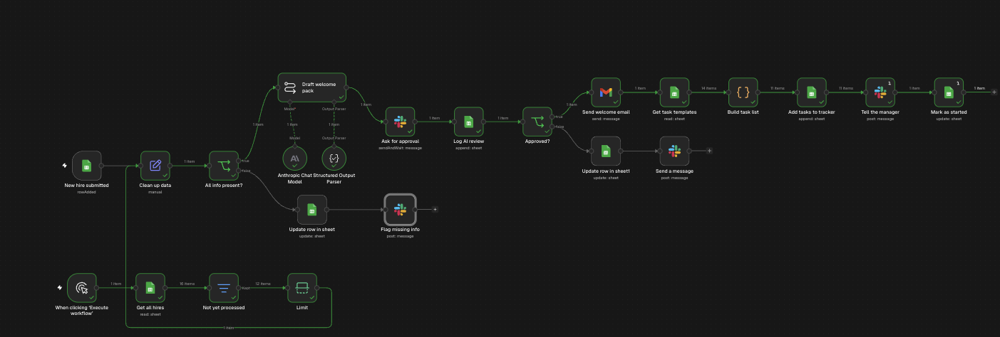

# People Ops Onboarding Agent

AI-assisted new-hire onboarding with a human in the loop.
Built with n8n, Claude (Anthropic), Google Workspace and Slack.

> · Practice project · Details are fictional.

## What it does
1. A recruiter submits a short form about a new hire.
2. The workflow checks the data and flags anything missing.
3. Claude drafts a personalised welcome email, a first-week plan and a note for the manager.
4. A People Ops reviewer approves or rejects the draft in Slack – nothing is sent without approval.
5. On approval: the email is sent, onboarding tasks are created with due dates,
   the manager is notified, and every AI draft and decision is logged.

## Design principles
- **AI drafts, a human decides.**
- **Rules, not AI, for anything that must be exact:** dates, tasks, recipients.
- **Data minimisation:** no ID numbers, salary or health data in the workflow.
- **Tested against misuse:** incomplete data, prompt injection, sensitive information.

## How it would run in a real company

This lab uses Google Sheets and a personal Slack workspace. In production, the same
workflow would sit on top of the company's HR systems, with a clear owner for every step.

### Who does what

| Step | Owner | How it works in production |
|---|---|---|
| Enter new-hire data | Recruiter (ATS) / People Ops coordinator (HRIS) | An accepted offer in the ATS (e.g. Ashby) creates the employee record in the HRIS (e.g. HiBob), which starts the workflow |
| Receive "needs fixing" alerts | The recruiter who owns the hire, with the People Ops channel copied | Direct Slack message naming the missing field, with a link to the record |
| Fix the data | Recruiter / People Ops coordinator | Corrected **in the source system**, never in a side copy; the update (or a *Retry* button) restarts the workflow |
| Approve or reject AI drafts | People Ops / onboarding specialist, with a named backup | Reviews the welcome pack in Slack before anything reaches the new hire |
| Technical failures | People Tech / HR systems | Error alerts go to People Tech, not to recruiters |
| Prompt and rule changes | People Ops + People Tech | Monthly review of rejection reasons and AI flags |
| Data protection and AI governance | Head of People, DPO / Legal (and employee representatives where required) | Approves the use case before launch; reviews it every 6 months |

### When a draft is rejected
1. The reviewer selects a reason (e.g. *wrong facts*, *tone*, *used information it shouldn't*).
2. They edit and send the email themselves, so the new hire is never delayed.
3. The reason is logged; recurring reasons lead to changes in the AI instructions.

### Service levels
- Approvals within **1 working day**; after 24 hours a reminder goes to the backup approver.
- Data fixes before the first pre-start task is due (usually 14 days before the start date).

### What we would measure
| Metric | What it tells us |
|---|---|
| Admin time per hire (before vs after) | Whether the automation saves real time |
| Share of hires flagged for missing data | Whether recruiting collects the right data early enough |
| Time from flag to fix | Whether ownership of fixes is clear |
| Draft rejection rate and reasons | Whether the AI instructions need improving |
| Tasks completed on time | Whether onboarding actually runs better for new hires |

### Lab vs production
| In this lab | In production |
|---|---|
| Google Form + Sheet | HRIS / ATS records and webhooks |
| Match on personal email | Match on a unique employee ID |
| One reviewer (me) | Named approver + backup, with response times |
| Reject stops the flow | Reject with reason, then edit and send manually |
| Runs on a laptop | Hosted on a server, so approvals work from any device |

## Coming soon
Workflow files, demo video, 16-case test results and a governance note
(GDPR, EU AI Act, Swedish co-determination).

## Contact
[LinkedIn](https://www.linkedin.com/in/thaiz-wyns)
